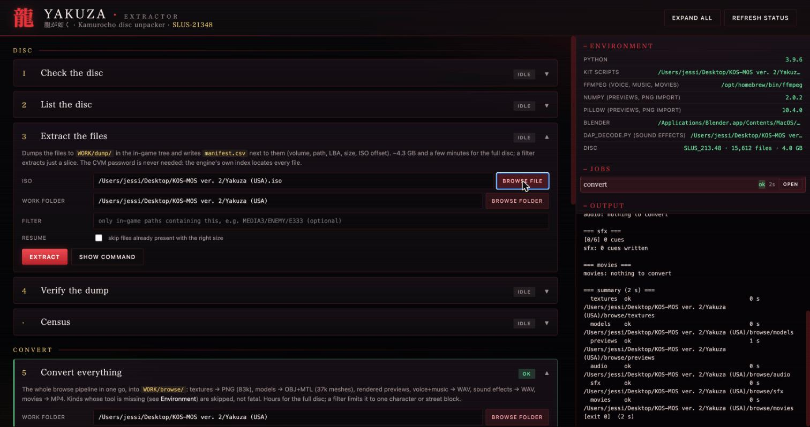

# Yakuza (PS2) Python Extractor

Unpacks, converts and repacks the files on the **Yakuza (USA, SLUS-21348)**
PlayStation 2 disc. Pure Python, nothing to install for the core. Point it
at your own disc image and it will:

* unpack all 15,612 files (4.3 GB) inside the four `OGRE*.CVM` volumes. The
  CVM password is not needed: the game carries its own directory index;
* convert them to things you can open: textures to PNG (83k), models to
  OBJ + MTL with textures attached (37k meshes), characters into Blender,
  voice and music to WAV, sound effects to WAV, movies to MP4, and a
  rendered preview picture of every mesh;
* write changes back into a bootable ISO: swap any file, or put a PNG
  straight into a texture slot.

**Status: works on my disc, looking for testers.** Texture mods have been
booted in PCSX2 (see below). If something fails on your image or machine,
[open an issue](https://github.com/LinuxJessi/YakuzaPythonExtractor/issues)
with what happened.

No game data is in this repo, apart from a few seconds of audio in
`docs/samples/` so you can hear what the converters produce. It is the
companion to the
[Xenosaga I](https://github.com/LinuxJessi/Xenosaga1PythonExtractor) and
[Xenosaga III](https://github.com/LinuxJessi/Xenosaga3PythonExtractor)
extractors: same GUI, different engine. The file formats are written up
in [docs/FORMATS.md](docs/FORMATS.md).

---

## Quick start

### The app (nothing to install)

Download the bundle for your system from the
[Releases page](https://github.com/LinuxJessi/YakuzaPythonExtractor/releases),
unzip it, and double-click:

| | |
|---|---|
| Windows | `Yakuza-Extractor-windows/Yakuza-Extractor.exe` — SmartScreen may ask once (unsigned download): *More info → Run anyway*. Unzip the whole folder; the GUI needs `yakuza-cli.exe` next to it. |
| macOS | `Yakuza-Extractor.app` — first time: right-click → Open (Gatekeeper, the app is not notarized) |

The bundle carries Python, numpy, Pillow and a portable ffmpeg, so every
card works out of the box; only *Open in Blender* needs Blender installed.
`yakuza-cli` in the same folder is the command line (`yakuza-cli cli probe …`,
`yakuza-cli browse textures …`, one word per script below).

### From a source checkout

| OS | Double-click | or from a terminal |
|---|---|---|
| Windows | `launch.bat` | `py gui.py` |
| macOS | `launch.command` (first time: right-click → Open) | `python3 gui.py` |
| Linux | `launch.sh` | `python3 gui.py` |

Python 3.9 or newer. Unpacking, textures, models, sound effects and
repacking need nothing else; `pip install -r requirements.txt` (numpy +
Pillow) adds the rendered previews and PNG texture import, and ffmpeg on
PATH adds voice, music and movies.

### The GUI

A local web page opens with one collapsible card per command, in four
groups:

| Group | Cards |
|---|---|
| Disc | **check the disc** (serial, volumes, file count), **list**, **extract** (writes `manifest.csv`, resumable), **verify the dump** (against the manifest, and the disc itself), census |
| Convert | **convert everything** (one click: textures, models, previews, voice + music, sound effects, movies; kinds whose tool is missing are skipped, not fatal), and one card per kind |
| Look | **open a character in Blender** (presets for Kiryu, Majima, a street block, or any set / path) |
| Mod | **import a texture**, **replace a file**, **verify an ISO** |

Every card has file pickers (your ISOs are detected and offered as quick
picks), a **Show command** button that prints the exact command line it
would run, and an **Open output folder** button afterwards. The right-hand
panel shows which optional tools were found (ffmpeg, numpy, Pillow,
Blender, the sound-effect decoder), whether the chosen ISO really is the
Yakuza (USA) disc, the list of jobs run this session with a **Stop** button
for the running one, and the live log. Paths are checked before a job
starts, so a typo is a one-line error, not a traceback. A single **work
folder** holds everything: `WORK/dump/` for the files and
`WORK/browse/{textures,models,previews,audio,sfx,movies}/` for the
conversions.



Everything the GUI does shells out to the scripts below, so GUI and
command line can never disagree.

### The command line

```sh
python3 cli.py probe   "Yakuza (USA).iso"                 # serial, volumes, file count: is this the right disc?
python3 cli.py list    "Yakuza (USA).iso" [--volume MEDIA3] [--filter E333]   # every file: size, LBA, path
python3 cli.py extract "Yakuza (USA).iso" --out dump      # unpack, in-game tree + manifest.csv (--skip-existing resumes)
python3 cli.py verify-dump dump --iso "Yakuza (USA).iso"  # every manifest row: present, right size, first 4 KB match the disc
python3 cli.py census  "Yakuza (USA).iso"                 # extension × magic table

python3 cli.py convert --dump dump --out out              # the whole browse pipeline below in one command
                       [--kinds textures,models,previews,audio,sfx,movies] [--filter E333] [--jobs 8]

python3 browse.py textures dump out/textures              # TXBP packs → PNG
python3 browse.py models   dump out/models                # OME meshes → OBJ + MTL
python3 render.py dump out/textures out/previews          # textured preview PNGs (numpy + Pillow)
python3 blender_open.py out/models E333                   # a character in Blender

python3 media.py audio  dump out/audio                    # AHX voice + ADX music → WAV (ffmpeg)
python3 media.py sfx    dump out/sfx                      # ps2_DTPK banks → WAV
python3 media.py movies dump out/movies                   # SFD → MP4 (ffmpeg)

python3 repack.py texture "Yakuza (USA).iso" --file /MEDIA/PLAYER/PLAYER0.DAT \
                          --leaf /0/0 --index 0 --png my_suit.png --out modded.iso
python3 repack.py patch   "Yakuza (USA).iso" --file /MEDIA/MAP/MAP_ADV.DAT --with edited.dat --out modded.iso
python3 repack.py verify  modded.iso
```

Every converter takes `--filter SUBSTRING` to limit itself to matching
in-game paths (`--filter MEDIA/PLAYER`, `--filter E230`) and `--jobs N`
for parallelism.

### Building the app yourself

```sh
python -m pip install pyinstaller numpy pillow
python build.py --clean          # dist/Yakuza-Extractor-windows/ on Windows, dist/Yakuza-Extractor.app on macOS
```

PyInstaller does not cross-compile, so build on the OS you want binaries
for. Drop a portable `ffmpeg` / `ffmpeg.exe` into `packaging/tools/` first
and it is bundled. The GitHub Actions workflow builds both bundles on
every `v*` tag and attaches them to a draft release.

---

## What's on the disc

| In-game path | Contents | Converted by |
|---|---|---|
| `MEDIA/PLAYER/*.DAT` | Kiryu — adventure / battle / event outfits, prison uniform (`*B.DAT`) | textures, models |
| `MEDIA3/ENEMY/Exxx/` | every enemy, NPC and story character (463 sets: `E…00` body, `E…01` head, 02–05 LODs) — Majima is **E230/E231**, shirtless Kiryu with the dragon tattoo is **E333** | textures, models, Blender |
| `MEDIA3/ENEMY/ENECOMMON.DAT` | the shared hands (meshes 13/14 + six poses) every enemy borrows | models, Blender |
| `MEDIA3/ARC/*.ARC` | Kamurocho street blocks by time of day / weather (`DAY_`, `NIGHT_`, `RAIN_`, `OLD_`, `ST_`) | textures, models, previews |
| `MEDIA/STAGE/`, `MEDIA/INDIVIDUALOBJ/`, `MEDIA/WANDERER/`, `MEDIA/PEOPLE/` | interiors, props, street NPCs | textures, models |
| `MEDIA/PAUSEMENU/TEX/` | item icons | textures |
| `MEDIA/TALK/PICTURE/*.SGT` | talk portraits (64-tile sheets) | textures |
| `MEDIA/SE/`, `MEDIA/SESET/` | sound-effect banks (`ps2_DTPK`) | sfx |
| `MEDIA2/SOUND/*.AHX` | 4,813 voice clips, named by speaker and scene | audio |
| `MEDIA2/BGM/*.ADX` | 132 music tracks | audio |
| `MEDIA2/MOVIE/*.SFD` | 41 FMV cutscenes | movies |
| `MEDIA2/AUTHOR/` | real-time cutscene streams (`.B##`) — not yet decoded | — |
| `MEDIA/TALK/**/TALK_*.BIN` | dialogue / message text — glyph-indexed, not yet decoded | — |
| `MEDIA4/MODULE/*.BIN` | minigame code overlays (Metrowerks `MWo3`) | — |

Output mirrors the in-game path: `MEDIA/PLAYER/PLAYER0.DAT` yields
`out/textures/MEDIA/PLAYER/PLAYER0.DAT/0-0_0.png` (container leaf `/0/0`,
texture 0) and `out/models/MEDIA/PLAYER/PLAYER0.DAT/1-0.obj` + `.mtl` +
`.json`.

---

## Use cases

### 3D models

`browse.py models` writes every mesh as OBJ with UVs and normals, one
group per sub-mesh, and an MTL whose materials point at the sibling PNGs.
Open any `.obj` with macOS Quick Look or Blender and the textures come
along. The accompanying `.json` sidecar records bone-derived attachment
points.

Characters are split across files (body, head, and shared hands), so use
`blender_open.py` to assemble one:

```sh
python3 blender_open.py out/models E230     # Majima
python3 blender_open.py out/models E333     # shirtless Kiryu, tattoo included
python3 blender_open.py out/models MEDIA/PLAYER/BATTLE.DAT
python3 blender_open.py out/models MEDIA3/ARC/DAY_KAB0000.ARC   # a whole street block
```

It launches Blender with the parts imported, textures bound, the shared
hands snapped to the wrists and given the body's skin material. Known
limits: hands keep the generic rest-pose angle, and player head meshes are
single-material where the game layers face + hair sheets, so one of the two
is approximated. Skeletons (`OMZ`) and motion (`.OMT`) are not exported
yet, so meshes come out in the rest pose, unrigged.

Want to just look? `render.py` draws a textured, lit preview PNG of every
mesh and a composite per file, so you can flip through 37k meshes in an
image viewer.

### Texture mods

```sh
python3 browse.py textures dump out/textures --filter MEDIA/PLAYER/PLAYER0.DAT
# edit out/textures/MEDIA/PLAYER/PLAYER0.DAT/0-0_0.png (keep the size)
python3 repack.py texture "Yakuza (USA).iso" --file /MEDIA/PLAYER/PLAYER0.DAT \
        --leaf /0/0 --index 0 --png edited.png --out modded.iso
python3 repack.py verify modded.iso
```

The PNG is quantised to the slot's original palette size (16 or 256
colours; RGBA32 slots take the pixels as-is), re-encoded, recompressed with
the engine's own LZSS, written back into the container with every offset
preserved, and the disc index updated. The only constraint is that the new
texture must compress to no more than the original — flat or painterly
edits always do; heavy photo detail may not, and the tool tells you.
Checked two ways: a red-tinted suit imported into a copy of the disc
comes back red when re-extracted (through the palette quantisation) with
neighbouring files untouched, and the patched ISO boots in PCSX2 with the
change showing in-game (screenshots below).

### Replacing any file (translation and other data mods)

`repack.py patch` writes an edited file over its original extent and fixes
the size in the `OGREDIR` index. Works for anything on the disc as long as
the replacement fits in the sectors the original occupied (same count or
fewer). Those two writes are the whole story: file bodies in the CVMs are
plain, and the game resolves paths through `OGREDIR*.BIN`, never through
the scrambled ISO directories.

**Translation status.** The USA release is already English. The dialogue
files (`MEDIA/TALK/**/TALK_*.BIN`) have no readable strings; the text is
stored as glyph indices into the game's font sheets. A text export/import
pair is the missing piece for a re-translation. The repacker, container
walker and AVLZ compressor it needs are in place.
See the open threads in [docs/FORMATS.md](docs/FORMATS.md).

### Audio and video

Voice, music and movies are stock CRI formats, so `media.py` only drives
ffmpeg. One catch: 80% of the voice clips use an AHX header variant that
ffmpeg refuses, so the tool relabels that byte on the way in. Sound-effect banks are
the same `ps2_DTPK` container Xenosaga III uses, decoded with that kit's
pure-Python SPU-ADPCM decoder.

---

## Modules

| File | Role |
|---|---|
| `iso9660.py` | minimal ISO reader (shared with the Xenosaga I kit) |
| `cvm.py` | CRI ROFS header probe |
| `ogredir.py` | the `OGREDIR*.BIN` index → file list |
| `avlz.py` | AVLZ LZSS decoder + compatible encoder |
| `containers.py` | recursive `TLFD` container walker |
| `txbp.py` | texture packs → RGBA / PNG |
| `ome.py` | meshes → OBJ, bone helpers, wireframe debug renderer |
| `texbind.py` | binds a mesh's texture ids to the right sibling pack |
| `render.py` | numpy software rasteriser → textured preview PNGs |
| `blender_open.py` | assemble a character / folder and open it in Blender |
| `media.py` | ffmpeg-driven voice/music/movie conversion, DTPK SE banks |
| `dap_decode.py` | the `ps2_DTPK` sound-bank decoder (pure-Python SPU ADPCM; shared with the Xenosaga III kit) |
| `repack.py` | write files and textures back into the ISO; verify |
| `cli.py` | probe / list / extract (+ manifest) / verify-dump / census / convert |
| `browse.py`, `gui.py` | the texture and model converters, and the local web GUI over all of the above |
| `tool.py`, `build.py`, `packaging/` | the one-word dispatcher the bundled `yakuza-cli` runs, and the PyInstaller build |

## Audio samples

Short clips from the converters, so you know what to expect before
running them (96 kbps MP3, in `docs/samples/`):

| File | What it is |
|---|---|
| `bgm_btl_boss_excerpt.mp3` | first 20 s of the boss battle theme (`MEDIA2/BGM/BTL_BOSS.ADX`) |
| `bgm_club_floor_excerpt.mp3` | 15 s of the club floor ambience (`AMB_CLUB_FLOOR.ADX`) |
| `voice_kiryu_17_034.mp3` | a Kiryu line from chapter 17 (`MEDIA2/SOUND/KIRYU_17_034.AHX`) |
| `voice_haruka_06_025.mp3` | a Haruka line from chapter 6 |
| `voice_nishiki_01_007.mp3` | a Nishiki line from chapter 1 |
| `sfx_02028_AMB28_c13.mp3` | one cue from a sound-effect bank (`MEDIA/SE/02028_AMB28.DAT`) |

The voice clips are 48 kHz mono as stored; music is 48 kHz stereo ADX.

## Where the formats came from

Everything here was worked out from the disc and the game's own program.
The CVM layout and the `OGREDIR` index came from the strings in
`MAIN.BIN`; AVLZ turned out to be plain LZSS once the right bit order and
match encoding were tried against the first directory block; the
container, texture and mesh formats came from staring at the data and
checking each guess by rendering it. Open questions are listed at the end
of [docs/FORMATS.md](docs/FORMATS.md). If you know the dialogue text
encoding or the skeleton format, I would like to hear from you.

## License

MIT, see [LICENSE](LICENSE). Yakuza is © SEGA. This repo contains no game
assets beyond the audio excerpts above.
